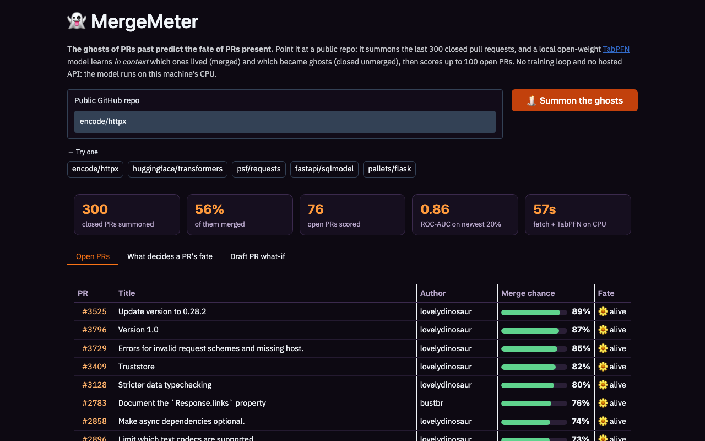
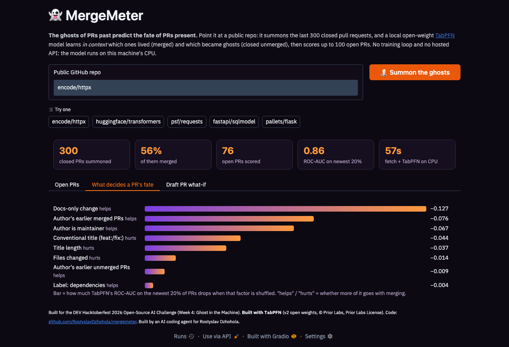
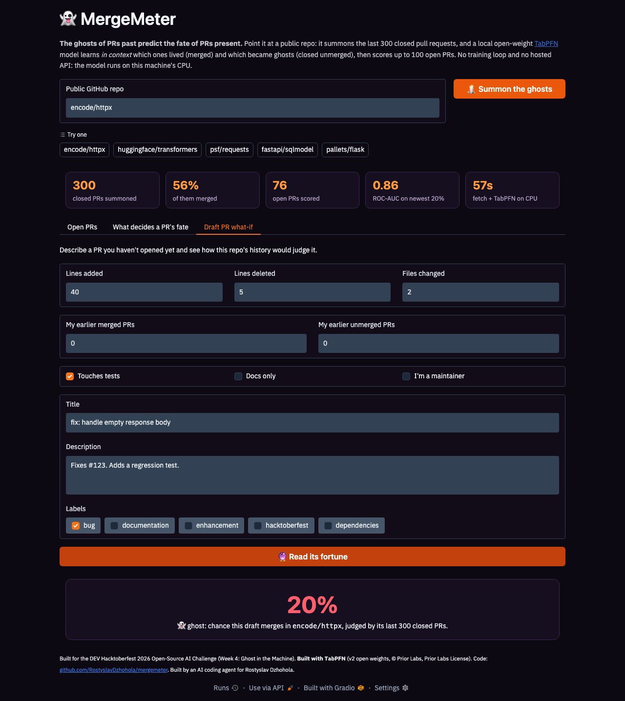

# 👻 MergeMeter: will my PR get merged?

**The ghosts of PRs past predict the fate of PRs present.**

Give MergeMeter a public GitHub repo. It summons that repo's last 300 closed pull requests (the ones that
lived, merged, and the ghosts, closed without merging) and hands them to
[TabPFN](https://github.com/PriorLabs/TabPFN), an open-weight tabular foundation model, as context. TabPFN
reads the history *in context* (no training loop) and scores every open PR, or a draft you haven't opened yet,
with a merge probability and the factors that decide a PR's fate in that repo.



- **Run it locally:** `python app.py` (see [Run it](#run-it)); the repo is also a ready-to-push Hugging Face Docker Space
- **Video (75 s):** [docs/mergemeter-demo.mp4](docs/mergemeter-demo.mp4)
- **Evaluation:** [EVAL.md](EVAL.md): TabPFN vs logistic regression on 8 real repos

## Why

Every Hacktoberfest, thousands of PRs end up as ghosts: closed, unmerged, haunting someone's profile. Most
contributors never find out *why*. Each repo has its own unwritten rules: one merges only maintainers'
work, another rejects docs-only typo fixes, a third merges anything with a test and a linked issue. Those
rules are written in its PR history, and MergeMeter reads them back to you before you spend an evening on a PR.

## What you get

| Tab | What it shows |
|---|---|
| **Open PRs** | Every open PR with its merge chance: 🌼 alive (≥ 70 %), 🕯️ limbo, 👻 ghost (< 40 %) |
| **What decides a PR's fate** | Permutation importance: how much TabPFN's ROC-AUC on the newest 20 % of PRs drops when each factor is shuffled, and whether more of it helps or hurts |
| **Draft PR what-if** | Describe a PR you haven't opened (size, tests, linked issue, title, labels, your track record) and get its fortune |




## How it works

```
owner/repo ─▶ GitHub GraphQL (300 closed + 100 open PRs, cached 6 h)
           ─▶ 20 leakage-safe features per PR          (mergemeter/features.py)
           ─▶ TabPFN v2, local CPU, in-context fit     (mergemeter/model.py)
           ─▶ open-PR scores, factor ranking, what-if  (app.py, Gradio)
```

**Features** (only what was knowable at open time or in the first 24 hours):
lines added and deleted, files changed, touches tests, docs-only, author is maintainer, author is a bot, the
author's earlier merged and unmerged PRs, links an issue, title and description length, conventional-commit
title, comments and reviews from others in the first 24 h, and topic labels (bug, docs, feature,
hacktoberfest, dependencies).

**Leakage guards.** A merge predictor can cheat easily, and the cheats look great in a notebook. MergeMeter avoids:
- `author_association`: GitHub rewrites `FIRST_TIME_CONTRIBUTOR` to `CONTRIBUTOR` *after* a merge, so it
  leaks the label. Author history is counted from earlier PRs in the window instead.
- Verdict labels (`hacktoberfest-accepted`, `stale`, `wontfix`, `invalid`, ...) are dropped.
- Comments stop at 24 h *and* 10 minutes before the close, so "Thanks, merged!" never counts.
- Time-to-close is never a feature. EVAL.md also reports a time-ordered split (train on old PRs, test on new).

**Why TabPFN.** 300 rows is too few for gradient boosting to shine and far too few to train a neural net.
TabPFN was pre-trained on millions of synthetic tables, so it does Bayesian-style inference on a small
table in one forward pass, handles missing values natively, and needs no hyperparameter search per repo.
That is exactly the shape of "one small table per repo, scored on demand".

## Ghost in the Machine: why open weights matter

The ghost here is literal: a model whose weights you can hold. TabPFN runs **inside this process on a
CPU**. The PR table never leaves the machine running MergeMeter (only the GitHub API is called), there's no
per-call bill, no API key and no rate limit on predictions, and the checkpoint can't be retired out from
under you. Point it at a private repo with your own token and nothing goes to a third-party model host.
A hosted model API would need every contributor's PR history shipped to someone else's server.

We pin the **TabPFN v2 classifier** checkpoint (Prior Labs License: Apache 2.0 plus attribution), which downloads over plain HTTP with no token. TabPFN
2.5 / 3.x checkpoints are newer but require a browser licence click-through and are non-commercial, so
they're not the default here. The hosted `tabpfn-client` API is not used at all.

## Run it

```bash
pip install -r requirements.txt
export GITHUB_TOKEN=...      # optional: any token, no scopes needed for public repos
python app.py                # http://localhost:7860
```

The first run downloads the 29 MB TabPFN v2 checkpoint. Without `GITHUB_TOKEN`, MergeMeter uses the
unauthenticated REST list endpoint ("lite mode": no PR sizes, files or early comments; TabPFN treats them as
missing) and the bundled snapshots in `data/snapshots/` for the example repos.

```bash
docker build -t mergemeter . && docker run -p 7860:7860 -e GITHUB_TOKEN mergemeter
pip install -r requirements-dev.txt && pytest          # feature-extraction tests
python scripts/eval.py                                 # rebuild EVAL.md from snapshots
```

## Honest limits

- It predicts *this repo's past behaviour*, not the quality of your code. A great PR to a repo that never
  merges outside contributions will score low, and that is the point.
- 300 PRs is a small sample; see the ± spread in EVAL.md.
- PR size features are final sizes, not size at open time.

## AI-help disclosure

MergeMeter was designed, written, tested and evaluated by an AI coding agent (Claude, running in T3 Code)
for Rostyslav Dzhohola, as an entry to the DEV Hacktoberfest 2026 Open-Source AI Challenge, Week 4
(Ghost in the Machine).

## License

MIT for this code. **Built with TabPFN.** The TabPFN v2 checkpoint is © Prior Labs under the
[Prior Labs License](https://priorlabs.ai/tabpfn-license/) (Apache 2.0 with an attribution requirement);
the `tabpfn` package is Apache 2.0.
